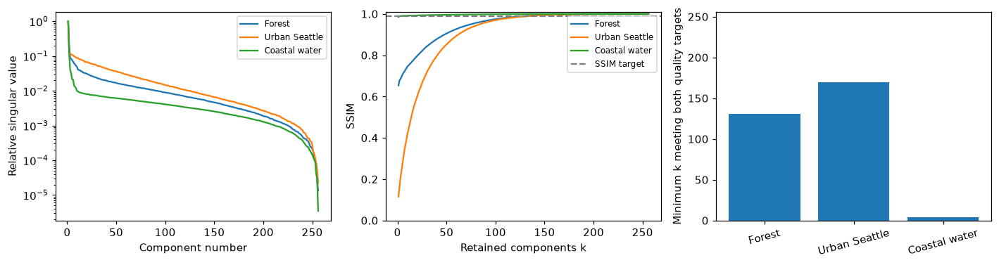
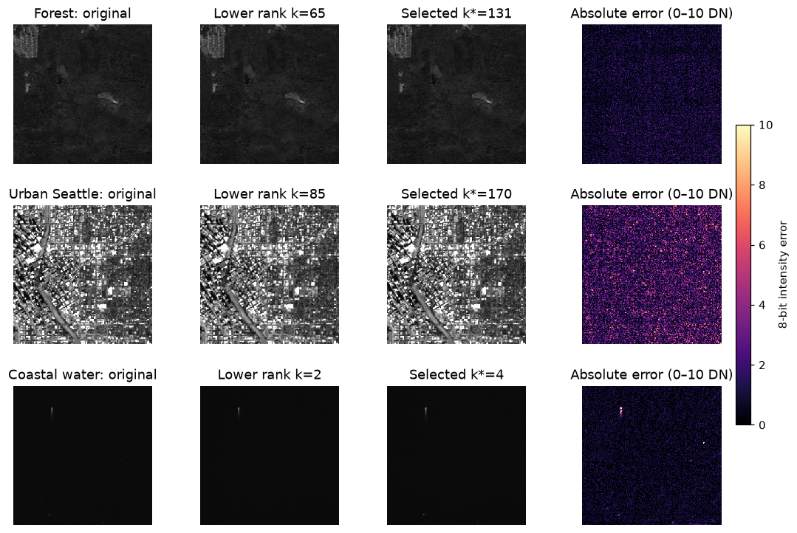

# SVD image reconstruction lab

This completes `algebra.ipynb` using the supplied **ejaj.jpg** first, followed by **one georeferenced Sentinel-2 GeoTIFF** of Seattle, nearby forest, and Puget Sound. Three equal 256×256 crops at native 10 m resolution compare forest, urban land, and coastal water. The notebook contains saved outputs, comments, measurements, and observations.

## Run locally with uv

From the repository root (the parent of `lab1/`):

```sh
uv sync
uv run jupyter server
```

Open `lab1/algebra.ipynb` in the displayed local notebook interface, then **Restart Kernel and Run All Cells**. Keep the default Python 3 kernel: Jupyter and the kernel both run in the uv environment. Python 3.12 is selected by `.python-version`; `uv.lock` records the resolved dependencies.

If you already have a Jupyter configuration overriding the start page, open `/tree` on the server's displayed URL. There are no Colab or Google Drive dependencies.

## Download the satellite image separately

```sh
uv run python lab1/download_satellite.py
```

The script saves exactly one satellite image: `lab1/data/satellite/seattle_sentinel2.tif`. It reads a geographic window from a public Cloud Optimized GeoTIFF using HTTP range requests, retaining the CRS, transform, and native pixels. No account or API key is required. If the image already exists, the script validates and reuses it. Delete that one TIFF to force a fresh download. Source details are in `lab1/data/satellite/source.json`.

The image is already included, so the notebook can run without downloading it again. It is a true georeferenced GeoTIFF, rather than a JPEG renamed to `.tif`.

## Visible results

- [Executed notebook](algebra.ipynb): local image SVD, satellite SVD, component counts, shifted-component comparison, and conclusions.
- [Observations and figures](results/observations.md): a readable results report.
- [Per-crop measurements](results/satellite_metrics.csv) and [shifted-component measurements](results/shifted_metrics.csv).
- [Crop locations](results/crop_locations.json): reproducible pixel windows and geographic centers.





The minimum retained rank is the first meeting **SSIM ≥ 0.99 and PSNR ≥ 40 dB**. This is an explicit quality proxy, supported by reconstruction and error panels, rather than a guarantee of perceptual indistinguishability. The worksheet's “eigenvalues” are singular values in SVD. We compare both equal-count components 1–20 vs 10–29 and the literal 10–30 interpretation of its wording. All image comparisons use the same 0–255 display scale.

There is one crop per terrain from a single acquisition. This is a small descriptive experiment, not a claim about all terrains. Puget Sound is coastal marine water, not open ocean. Analysis concerns grayscale rendered RGB at this resolution, not multispectral reflectance.

## Source

Contains modified Copernicus Sentinel data (2024), Sentinel-2B L2A true color, acquired **29 August 2024**, item **S2B_10TET_20240829_0_L2A**, distributed via Earth Search / AWS Open Data.

- [Scene metadata](https://earth-search.aws.element84.com/v1/collections/sentinel-2-l2a/items/S2B_10TET_20240829_0_L2A)
- [Original RGB GeoTIFF asset](https://sentinel-cogs.s3.us-west-2.amazonaws.com/sentinel-s2-l2a-cogs/10/T/ET/2024/8/S2B_10TET_20240829_0_L2A/TCI.tif)

The saved TIFF is a Seattle-area spatial subset, EPSG:32610, with native 10 m pixels. Its true-color bands are display-scaled, not raw scientific reflectance. The local `ejaj.jpg` was supplied by the user.

## Share after pushing

Commit `lab1/` **with notebook outputs**, plus the uv configuration in the repository root. `.venv/` and caches are ignored. After pushing, share the repository URL or the GitHub URL of `lab1/algebra.ipynb`; its plots are already embedded and the README also displays the results.
