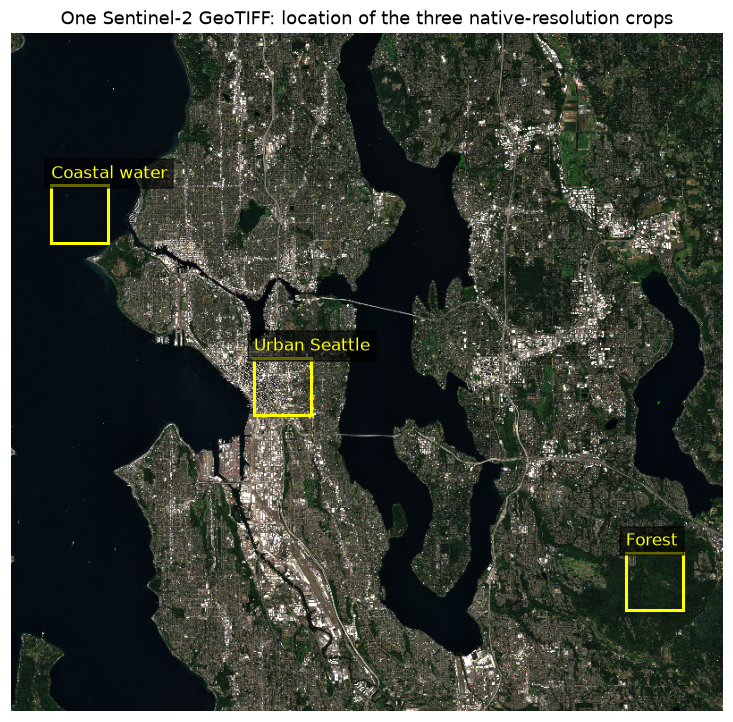
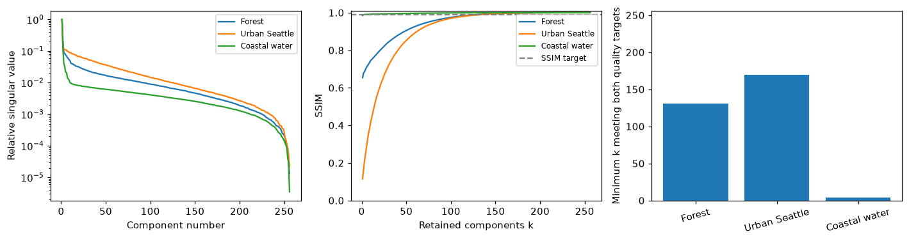
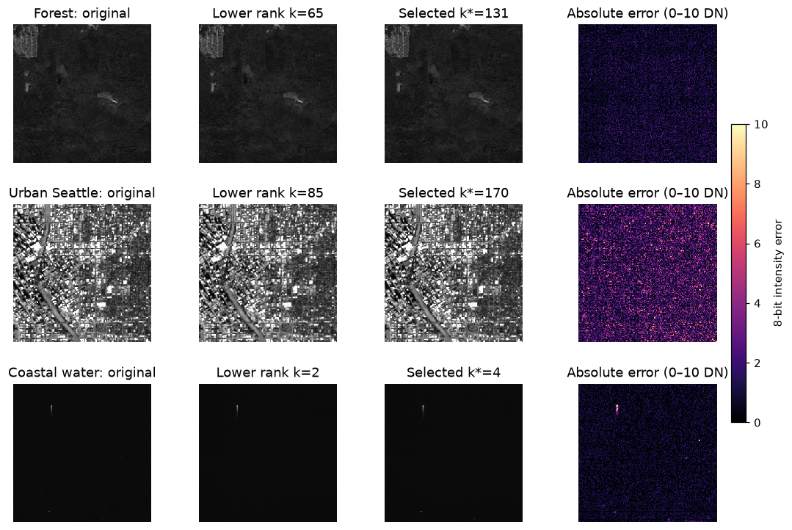
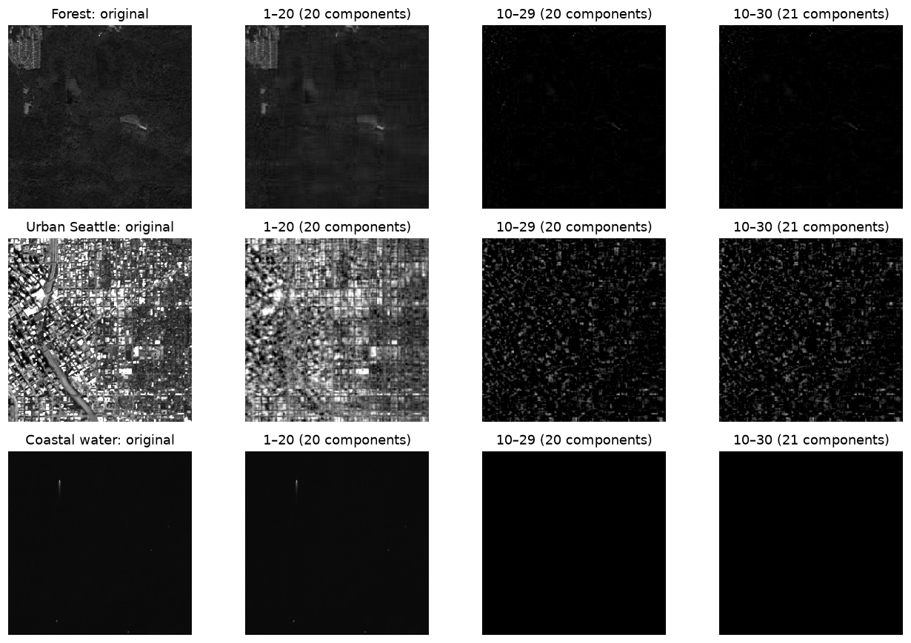

# SVD lab results

### 1. How many components are good enough?

For ejaj.jpg, 99% of squared energy needs 11 components, and 99.9% needs 70. The worksheet's k=70 reconstruction has SSIM=0.9264 and PSNR=36.35 dB. Low ranks recover the broad mug shape; increasing k restores the lettering, speckles and edges. Removing the first one or two components discards dominant intensity/shape information, so a reconstruction from the remainder loses important low-rank structure.

For the satellite crops, the SSIM ≥ 0.99 and PSNR ≥ 40 dB criterion gives:

- **Forest**: **131/256** components (51.2%), SSIM=0.9900, PSNR=47.75 dB.
- **Urban Seattle**: **170/256** components (66.4%), SSIM=0.9971, PSNR=40.06 dB.
- **Coastal water**: **4/256** components (1.6%), SSIM=0.9902, PSNR=49.68 dB.

### 2. Should the leading components be skipped?

No. In these examples the 10–29 and 10–30 reconstructions lose most of the image brightness and structure and have much larger relative errors. They contain residual detail, not a better reconstruction. The leading-k SVD is optimal for Frobenius error at the same rank. All panels use a fixed 0–255 scale; independent contrast stretching would hide this loss.

### 3. How does terrain change the required rank?

In this scene, **Coastal water** needs the fewest components (4), and **Urban Seattle** the most (170). Smooth intensity fields concentrate information in fewer components, while irregular fine detail requires more. Terrain labels alone do not determine compressibility. The lower-rank panels, selected panels and error maps allow visual checking of the quality proxy. This does not prove universal perceptual indistinguishability; it measures grayscale appearance at native 10 m resolution. The water crop is Puget Sound, a marine inlet. With one crop per terrain from one acquisition, these results should not be generalized statistically.

| terrain | k* | fraction (%) | PSNR (dB) | SSIM |
| --- | --- | --- | --- | --- |
| Forest | 131 | 51.1719 | 47.7493 | 0.9900 |
| Urban Seattle | 170 | 66.4062 | 40.0628 | 0.9971 |
| Coastal water | 4 | 1.5625 | 49.6760 | 0.9902 |

## Per-crop satellite measurements

| image | k* | k*/256 (%) | k (99% energy) | k (99.9% energy) | PSNR (dB) | SSIM |
| --- | --- | --- | --- | --- | --- | --- |
| Forest | 131 | 51.1719 | 49 | 131 | 47.7493 | 0.9900 |
| Urban | 170 | 66.4062 | 80 | 148 | 40.0628 | 0.9971 |
| Water | 4 | 1.5625 | 2 | 86 | 49.6760 | 0.9902 |

## Shifted-component measurements

| image | components | relative Frobenius error | PSNR (dB) | SSIM |
| --- | --- | --- | --- | --- |
| Forest | 1–20 (20 components) | 0.1510 | 34.1680 | 0.7961 |
| Forest | 10–29 (20 components) | 0.9903 | 17.8336 | 0.0003 |
| Forest | 10–30 (21 components) | 0.9901 | 17.8358 | 0.0003 |
| Urban | 1–20 (20 components) | 0.2950 | 16.8755 | 0.5999 |
| Urban | 10–29 (20 components) | 0.9601 | 6.6249 | -0.0081 |
| Urban | 10–30 (21 components) | 0.9589 | 6.6356 | -0.0083 |
| Water | 1–20 (20 components) | 0.0584 | 51.8382 | 0.9929 |
| Water | 10–29 (20 components) | 0.9993 | 27.1754 | 0.0503 |
| Water | 10–30 (21 components) | 0.9993 | 27.1757 | 0.0503 |

Source: Copernicus Sentinel-2B L2A true color, 29 August 2024; [Earth Search source metadata](https://earth-search.aws.element84.com/v1/collections/sentinel-2-l2a/items/S2B_10TET_20240829_0_L2A). One GeoTIFF, three 256×256 grayscale crops at native 10 m resolution.
